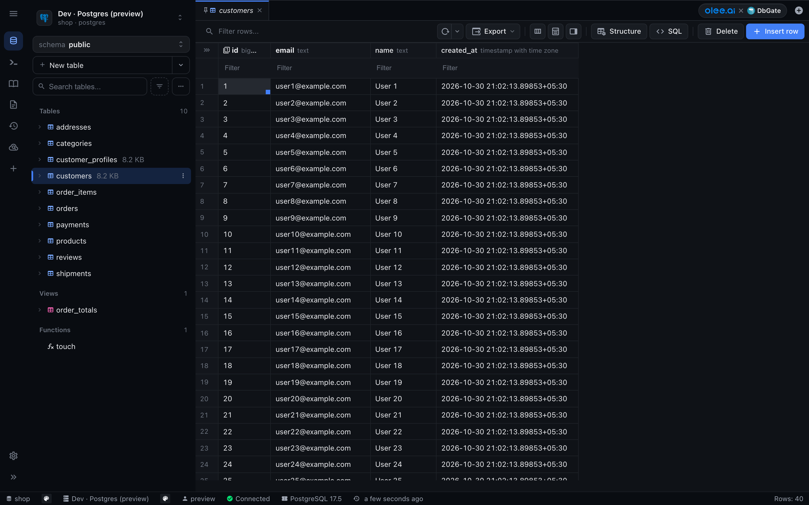

<p align="center">
  <a href="https://olee.ai"></a>
  &nbsp;&nbsp;<strong>×</strong>&nbsp;&nbsp;
  <a href="https://github.com/dbgate/dbgate"></a>
</p>

<h1 align="center">Olee AI × DbGate</h1>

<p align="center">
  Olee AI's fork of <a href="https://github.com/dbgate/dbgate">DbGate</a>, the web database manager, with a redesigned table editor, SQL editor and sidebar.
</p>

> [!IMPORTANT]
> **Olee AI internal use only. Not for distribution.** See [OLEE-INTERNAL-USE.md](OLEE-INTERNAL-USE.md).
>
> DbGate is created by Jan Prochazka and the DbGate contributors and is licensed under the
> [GNU General Public License v3.0](LICENSE). That license applies in full to this fork, including Olee AI's changes.
> For the original project, downloads and documentation, see [dbgate/dbgate](https://github.com/dbgate/dbgate) and [docs.dbgate.io](https://docs.dbgate.io).

<p align="center">
  <a href="img/olee-table-editor.png"></a>
</p>

## What this fork adds

Olee AI's changes sit on top of upstream DbGate releases (currently **7.3.3**, community edition).

**On `master`**

- **Olee blue redesign** of the app shell, table editor and SQL editor ([#1](https://github.com/oleeai/dbgate/pull/1))
  - Olee brand blue on cool neutrals, light and dark themes, all colors from a small set of base tokens
  - Connection switcher at the top of the sidebar, source-list style sidebar, expandable navigation rail
  - Table editor toolbar: "Filter rows" field, Insert row as the main action, Save/Revert only when there are changes
  - SQL Editor rail entry with saved queries and query history
- **Sidebar redesign** ([#3](https://github.com/oleeai/dbgate/pull/3))
  - Connection switcher with engine logos
  - Searchable schema picker with object counts
  - "New table" button, "Search tables…" row and ⋮ menus on rows
  - olee.ai × DbGate badge in the tab bar
  - Fix: the object list no longer gets stuck on "Loading database structure" after a reload or a lost event stream
- **CI** ([#2](https://github.com/oleeai/dbgate/pull/2)): runs the community test suites and publishes the Docker image to GHCR (see [CI and releases](#ci-and-releases))

**In review / not on `master` yet**

- Primary-key and foreign-key icons in the data grid column headers; the link icon opens the referenced table ([#4](https://github.com/oleeai/dbgate/pull/4), merged into the #3 branch after #3 landed, so it still needs to reach `master`)
- Table details tab: indexes, triggers, RLS policies, enums and check constraints, each with its SQL ([#5](https://github.com/oleeai/dbgate/pull/5), in review)
- Paging footer for table data: row count, page navigation, rows per page and quick CSV/JSON export ([#6](https://github.com/oleeai/dbgate/pull/6), in review)

## Run with Docker

The image is published to `ghcr.io/oleeai/dbgate` and is **private**. Log in with a GitHub token that has the `read:packages` scope:

```sh
echo "$GITHUB_TOKEN" | docker login ghcr.io -u <github-username> --password-stdin
```

It runs like the upstream DbGate image: the web UI listens on port `3000`, settings live in `/root/.dbgate`, and connections can be defined with environment variables.

```sh
docker run -d --name dbgate \
  -p 3000:3000 \
  -v dbgate-data:/root/.dbgate \
  -e CONNECTIONS=pg \
  -e LABEL_pg="Postgres" \
  -e ENGINE_pg=postgres@dbgate-plugin-postgres \
  -e SERVER_pg=db.example.com \
  -e PORT_pg=5432 \
  -e USER_pg=postgres \
  -e PASSWORD_pg=change-me \
  ghcr.io/oleeai/dbgate:latest
```

Or with Docker Compose:

```yaml
services:
  dbgate:
    image: ghcr.io/oleeai/dbgate:latest
    restart: unless-stopped
    ports:
      - '3000:3000'
    volumes:
      - dbgate-data:/root/.dbgate
    environment:
      CONNECTIONS: pg
      LABEL_pg: Postgres
      ENGINE_pg: postgres@dbgate-plugin-postgres
      SERVER_pg: db.example.com
      PORT_pg: 5432
      USER_pg: postgres
      PASSWORD_pg: ${PG_PASSWORD}

volumes:
  dbgate-data:
```

Then open http://localhost:3000. Add more connections by listing more ids in `CONNECTIONS` (`CONNECTIONS=pg,mysql`) with their own `LABEL_<id>`, `ENGINE_<id>`, … variables. The image has no login by default, so put it behind authentication or a private network. All options (logins, SSH tunnels, `WEB_ROOT`, …) are in the upstream [environment variable docs](https://docs.dbgate.io/env-vars).

## Develop

Requires Node.js 24+ and Yarn 1.

```sh
yarn          # install packages, build the TypeScript libraries and plugins
yarn start    # API on http://localhost:3000, web UI on http://localhost:5001
```

For more control, run `yarn start:api`, `yarn start:web` and `yarn lib` (watch libraries and plugins) in three terminals. Type-check with `yarn ts` and format with `yarn prettier`.

Tests:

```sh
yarn workspace dbgate-tools test          # unit tests (also filterparser, datalib, api)
cd integration-tests && yarn test:local   # integration tests, needs Docker
```

[CLAUDE.md](CLAUDE.md) describes the monorepo layout, the API and web architecture, plugins and code conventions.

## CI and releases

| Workflow | Runs on | What it does |
|---|---|---|
| [`run-tests.yaml`](.github/workflows/run-tests.yaml) | pushes and PRs to `master` | Integration tests (Postgres service) and the unit tests of filterparser, datalib, tools and api. Suites that need DbGate Premium sources are skipped. |
| [`docker-image.yaml`](.github/workflows/docker-image.yaml) | PRs, pushes to `master`, `vX.Y.Z` tags | PRs: builds the image (amd64) without pushing. `master` and tags: publish `ghcr.io/oleeai/dbgate` for `amd64` and `arm64`. |

Image tags:

| Tag | Source |
|---|---|
| `latest` | latest commit on `master` |
| `sha-<commit>` | each commit on `master` (short SHA), for pinning and rollbacks |
| `X.Y.Z` | a `vX.Y.Z` git tag |

The workflows use the built-in `GITHUB_TOKEN`; no extra secrets are needed. Upstream's release workflows (Electron apps, npm, Docker Hub, premium builds) are removed in this fork.

## Syncing with upstream

```sh
git remote add upstream https://github.com/dbgate/dbgate.git   # once
git fetch upstream --tags
git switch -c sync/upstream-vX.Y.Z origin/master
git merge vX.Y.Z                                              # an upstream release tag
```

Resolve conflicts in favor of Olee's changes, delete any upstream workflows the merge brings back, run the tests, then open a PR to `master`. Merge release tags, not upstream `master`.

## Supported databases

MySQL, MariaDB, PostgreSQL, CockroachDB, SQL Server, Oracle, SQLite, DuckDB, Firebird, ClickHouse, Apache Cassandra, MongoDB and Redis. Files: CSV, Excel, XML and DBF.

This fork is built from the DbGate community sources, so engines and APIs that need DbGate Premium (for example Amazon Redshift, DynamoDB, Cosmos DB, Firestore, GraphQL/OData/OpenAPI) are not included.

For the full feature list, plugins, scripting and everything else, see the [upstream README](https://github.com/dbgate/dbgate#readme) and [docs.dbgate.io](https://docs.dbgate.io).

## License

[GPL-3.0](LICENSE). DbGate is © Jan Prochazka and the DbGate contributors. Olee AI's changes are released under the same license. The internal-use notice in [OLEE-INTERNAL-USE.md](OLEE-INTERNAL-USE.md) is an Olee AI policy and does not change the license.
